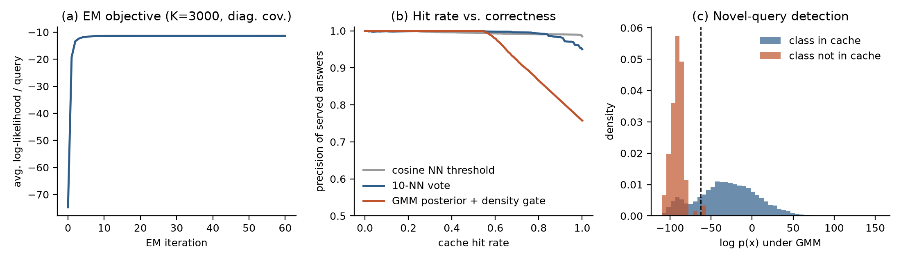

# Probabilistic Semantic Caching with Mixture Models

> When can an LLM safely reuse a cached answer? We treat that decision as posterior inference in a generative model of prompts and answers, and test it honestly against strong baselines on real LLM traffic.

LLM applications receive many near-duplicate prompts ("What's Canada's capital?" / "Which city is the capital of Canada?"). A **semantic cache** embeds each incoming prompt and returns a stored answer when it judges the prompt equivalent to one it has seen, which saves an expensive model call. Production caches such as GPTCache make that judgement with a single cosine-similarity threshold, which gives no control over how often a wrong answer is served.

This project models the cache decision probabilistically. A **mixture model fit by EM** (our own NumPy implementation) groups cached prompts into clusters, each with a learned distribution over the answers its prompts received. A new prompt is served from cache only when the model is confident about the answer *and* the prompt falls in a region of embedding space the model has seen.

**Where it stands (preliminary, Nov 2026):** on 63,796 real LM-Arena prompts from the [vCache](https://arxiv.org/abs/2502.03771) benchmark, with a cache filled in advance, a simple **10-nearest-neighbour vote beats our first Gaussian-mixture cache** (77.2% vs. 52.9% of queries served at 98% precision). We also found label noise in the benchmark and showed that the pre-filled setting is too easy to separate decision rules. The project now targets the realistic setting: a cache that starts empty and learns online, where pooling evidence across a cluster should matter most.



*(a) EM log-likelihood over iterations. (b) Precision of served answers against the fraction of queries served, for the cosine threshold, the 10-NN vote and the GMM; both nearest-neighbour rules dominate the GMM when the cache is pre-filled. (c) GMM log-density of queries whose class is or is not in the cache; the dashed line is the density gate.*

This is the course project for **CS275P (Probabilistic Machine Learning)**. The full proposal is in [`docs/`](docs/).

---

## Contents

- [How it works](#how-it-works)
- [Measured results](#measured-results)
- [What the preliminary results told us](#what-the-preliminary-results-told-us)
- [Setup](#setup)
- [Running the experiments](#running-the-experiments)
- [Project structure](#project-structure)
- [Design notes](#design-notes)
- [Limitations](#limitations)
- [Roadmap](#roadmap)
- [Team](#team)

---

## How it works

```
                    incoming prompt
                          │
                          ▼
              ┌───────────────────────┐
              │   Sentence embedding  │  precomputed gte (1,024-d) → L2-normalise → PCA (64-d, whitened)
              └───────────┬───────────┘
                          │  x
                          ▼
              ┌───────────────────────┐
              │  Mixture posterior    │  p(k | x) for every cluster k   (EM-fitted, diagonal cov.)
              └───────────┬───────────┘
                          │
            ┌─────────────┴──────────────┐
            ▼                            ▼
  ┌───────────────────┐        ┌───────────────────┐
  │ Answer confidence │        │  Density gate     │
  │ max_a Σ_k p(k|x)  │        │  log p(x) ≥ δ ?   │  rejects prompts unlike
  │        · θ_k,a    │        │                   │  anything in the cache
  └─────────┬─────────┘        └─────────┬─────────┘
            └─────────────┬──────────────┘
                          ▼
          confident AND in-distribution?
              │                       │
             yes                      no
              ▼                       ▼
     serve cached answer      call the LLM (cache miss)
```

**The model.** Each cached prompt has an embedding `x` and an answer `a`. The joint generative model is

```
z ~ Categorical(π)          cluster
x | z=k ~ p(x | φ_k)        prompt embedding (diagonal Gaussian now; von Mises–Fisher next)
a | z=k ~ Categorical(θ_k)  answer the prompt received
```

EM fits the mixture on the embeddings. `θ_k` is estimated from the soft cluster responsibilities of the cached prompts. At query time the predictive answer distribution is `p(a | x) = Σ_k p(k | x) θ_k,a`.

**Why two conditions.** A mixture posterior is close to 1 for *some* cluster even when a prompt is far from every cluster. The density gate `log p(x) ≥ δ` is what lets the cache say "I haven't seen anything like this."

---

## Measured results

### Main benchmark: vCache SemBenchmarkLmArena

63,796 prompts derived from real LM-Arena user queries, in 3,421 classes of paraphrases; a cached answer is correct if it has the query's class. Prompts are split at random: 31,898 fill the cache, 31,898 form the query stream (99.6% have their class in the cache). Each policy is swept over 400 thresholds; the table reports the largest fraction of queries served while precision stays at or above the target. Single seed.

| Labels | Cache policy | Served @ 90% | Served @ 95% | Served @ 98% |
|---|---|---|---|---|
| Original | Cosine threshold (GPTCache-style) | 100% | 0.003% | 0.003% |
| Original | 10-NN vote | 100% | **87.2%** | **77.2%** |
| Original | GMM, K = 600 | 2.5% | 2.3% | 2.0% |
| Original | GMM, K = 1500 | 23.1% | 20.3% | 18.8% |
| Original | GMM, K = 3000 | 64.9% | 57.2% | 52.9% |
| Merged | Cosine threshold | **100%** | **100%** | **100%** |
| Merged | 10-NN vote | 100% | 100% | 91.0% |
| Merged | GMM, K = 1500 | 29.6% | 25.6% | 23.4% |
| Merged | GMM, K = 3000 | 73.7% | 64.7% | 59.7% |

*"Merged" labels merge classes that contain an identical prompt text (202 classes removed); see finding 1.*

### Development set: CLINC150

150 intents standing in for answers, 1,000 out-of-scope queries, SIF-weighted GloVe embeddings. At 98% precision the GMM (K = 600) serves 14.8% of queries against 0.02% for the cosine threshold. We no longer treat this as evidence for the GMM: we did not run the 10-NN vote here, and LM-Arena showed that the vote is the baseline to beat.

---

## What the preliminary results told us

### 1. The benchmark has label noise, and it changes conclusions

350 prompt texts appear in more than one class (2.1% of rows). When a query's nearest cached prompt is word-for-word identical, the benchmark counts the reused answer as correct only 91% of the time. Under the original labels the GMM appeared to crush the cosine baseline at 98% precision; under merged labels, the plain cosine cache serves *every* query at 98% precision. We report both from now on.

### 2. Similarity alone does not predict correctness

Under the original labels, the cosine baseline's precision stays between 0.91 and 0.96 for every similarity from 0.80 to 1.00. Part of that is label noise; part is real: many classes are near-identical variants of the same puzzle ("how many sisters does Sally have?") whose correct answers differ. Whether a hit is safe depends on *where* the prompt falls, not just how similar it is.

### 3. Agreement among nearby cached answers is the signal, and the 10-NN vote uses it best so far

The GMM exploits the same signal (cluster purity rises from 0.41 at K = 600 to 0.89 at K = 3000), but it works in 64 PCA dimensions that keep only 47% of the variance, while the baselines use all 1,024. Part of its loss is that handicap.

### 4. A pre-filled cache is too easy

With about 18.6 prompts per class and half of them cached, nearly every query has a close paraphrase waiting. This setting cannot separate good decision rules. Real caches start empty, which is the setting vCache studies and where we go next.

### 5. Larger K overfits

BIC is best at K = 1500 among the values tried (4.57 × 10⁶ vs. 4.95 × 10⁶ at K = 600 and 4.73 × 10⁶ at K = 3000). At K = 3000 the density gate wrongly rejects 20% of answerable queries.

---

## Setup

Requires Python 3.9+. Tested on macOS with Python 3.11.

```bash
git clone https://github.com/Mish926/gmm-semantic-cache.git
cd gmm-semantic-cache

python3 -m venv .venv
source .venv/bin/activate          # if conda is active, run `conda deactivate` first
python -m pip install -r requirements.txt
python -m pip install -e .
```

`data/` is git-ignored; the scripts below recreate it.

---

## Running the experiments

```bash
python -m pytest -q                                   # EM sanity checks (3 tests)
```

**LM-Arena (main benchmark).** The vCache parquet files are 2–6 GB each, with embeddings stored as text. The prepare script reads only the columns it needs over HTTP range requests (about 1–1.5 GB, once) and saves a compact `.npz`:

```bash
python scripts/inspect_vcache.py                      # schema of all vCache benchmarks, no download
python scripts/prepare_vcache.py                      # -> data/processed/lmarena_gte.npz
python scripts/diagnose_lmarena.py                    # label noise + precision by similarity
python scripts/run_vcache_prelim.py --k 1500          # original labels
python scripts/run_vcache_prelim.py --k 3000 --merge-identical   # merged labels
```

**CLINC150 (development set).**

```bash
./scripts/download_data.sh                            # CLINC150 + GloVe into data/raw/
python scripts/run_prelim.py --k 600
```

Each run writes `results/*.json` (all metrics) and `figures/*.png` (the three-panel figure). Main options: `--k`, `--seed`, `--pca-dim`, `--max-iter`, `--density-quantile`, `--knn`, `--merge-identical`.

---

## Project structure

```
gmm-semantic-cache/
├── src/semcache/
│   ├── gmm.py          # diagonal-covariance GMM, EM implemented from scratch
│   ├── cache.py        # GMM posterior cache, cosine threshold, k-NN vote baselines
│   ├── vcache_data.py  # vCache loading, cache/stream split, identical-text class merging
│   ├── data.py         # CLINC150 loading
│   ├── embed.py        # SIF-weighted GloVe embeddings (CLINC150)
│   ├── metrics.py      # served-fraction vs. precision curves
│   └── plots.py        # three-panel results figure
├── scripts/
│   ├── inspect_vcache.py      # read benchmark schemas without downloading
│   ├── prepare_vcache.py      # download needed columns, parse embeddings
│   ├── diagnose_lmarena.py    # label-noise and similarity diagnostics
│   ├── run_vcache_prelim.py   # LM-Arena experiment
│   ├── download_data.sh
│   └── run_prelim.py          # CLINC150 experiment
├── tests/test_gmm.py   # EM correctness checks
├── docs/               # project proposal (PDF + Word)
├── results/            # committed JSON from every run
├── figures/            # committed figures
├── pyproject.toml
└── requirements.txt
```

---

## Design notes

**Why implement EM ourselves.** The course asks for our own learning algorithms, and owning the code lets us change the model (answer-aware E-step, online updates, von Mises–Fisher components) without fighting a library's API. All E-step computations run in log space with log-sum-exp.

**Why a k-NN vote baseline.** Once the GMM looked strong, the obvious question was whether the gain came from the mixture model or simply from looking at the answers of nearby cached prompts. The vote answers that directly, and it currently wins. Every new model has to beat it.

**Why report two label versions.** Merging classes that share an identical prompt removes errors no cache could avoid, but it is lenient: it can link families of related puzzles into one class (the largest merged class has 210 prompts). The truth lies between the strict and merged numbers, so we show both.

**Why thresholds come from score quantiles.** A fixed grid of thresholds can miss a policy's behaviour at its extremes. Quantile-based thresholds cover each policy's full range fairly.

**Why the proposal changed.** Our first results (on CLINC150, and on LM-Arena before the label-noise check) suggested the GMM beat the cosine baseline at strict precision. Stronger baselines and a label audit showed that conclusion did not hold. We kept the honest result and redesigned the project around the setting where the question is still open.

---

## Limitations

- **Pre-filled cache.** All current numbers fill the cache in advance; real caches start empty and learn online.
- **PCA handicap.** The GMM sees 64 dimensions (47% of the variance) while the baselines see 1,024.
- **Single seed.** Numbers come from one split and one initialisation; 5 seeds with confidence intervals will replace them.
- **No error-rate guarantee yet.** Policies are tuned on a precision curve, not bounded by a user-chosen error rate.

---

## Roadmap

1. **Online protocol.** Cache starts empty and inserts only on a miss (the vCache protocol); reproduce vCache's published numbers with its released code.
2. **von Mises–Fisher mixture.** EM on the full 1,024-d unit sphere, removing the PCA handicap.
3. **Bayesian error control.** A Beta–Bernoulli correctness model per cluster; serve only when the lower credible bound clears 1 − ε.
4. **Online EM and choosing K.** Incremental updates, new components for novel prompts, and a Dirichlet-process mixture fit by variational inference.
5. **Full evaluation.** Second benchmark (SearchQueries), two embedding models, 5 seeds, ablations, and a head-to-head with vCache.

---

## Tech stack

| Layer | Technology |
|---|---|
| Model | NumPy, SciPy: EM for mixture models, written from scratch |
| Data | vCache benchmarks via `huggingface_hub` + `pyarrow` (column-only reads); CLINC150 |
| Embeddings | Precomputed gte (1,024-d); GloVe + SIF for CLINC150; scikit-learn PCA |
| Baselines | Cosine threshold (GPTCache-style), k-NN vote |
| Plots and tests | Matplotlib, pytest |

---

## Team

Mishika Ahuja · Praavin Kumar · Svetya Koppisetty · Ved Mistry

*Course project for CS275P, Probabilistic Machine Learning.*

## References

- F. Bang. GPTCache: An open-source semantic cache for LLM applications. NLP-OSS Workshop, 2023.
- L. G. Schroeder et al. vCache: Verified semantic prompt caching. ICLR, 2026. [arXiv:2502.03771](https://arxiv.org/abs/2502.03771)
- W. Gill et al. MeanCache: User-centric semantic caching for LLM web services. IEEE IPDPS, 2025.
- MVR-cache: Optimizing semantic caching via multi-vector retrieval and learned prompt segmentation. [arXiv:2605.24914](https://arxiv.org/abs/2605.24914), 2026.
- A. Banerjee, I. S. Dhillon, J. Ghosh, S. Sra. Clustering on the unit hypersphere using von Mises–Fisher distributions. JMLR, 2005.
- A. P. Dempster, N. M. Laird, D. B. Rubin. Maximum likelihood from incomplete data via the EM algorithm. JRSS-B, 1977.
- S. Larson et al. An evaluation dataset for intent classification and out-of-scope prediction. EMNLP-IJCNLP, 2019.
