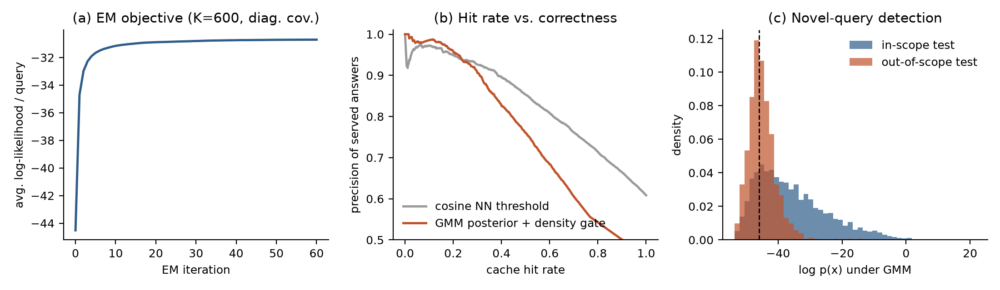

# Probabilistic Semantic Caching with Gaussian Mixture Models

> When can an LLM safely reuse a cached answer? We treat that decision as posterior inference in a generative model rather than a hand-tuned similarity cutoff.

LLM applications receive many near-duplicate queries ("What's Canada's capital?" / "Which city is the capital of Canada?"). A **semantic cache** embeds each incoming query and returns a stored answer when it judges the query equivalent to one it has seen, which saves an expensive model call. Production caches such as GPTCache make that judgement with a single cosine-similarity threshold, which gives no control over how often a wrong answer is served.

This project replaces the threshold with a **Gaussian mixture model fit by EM** (our own NumPy implementation). Each mixture component is a cluster of similar queries with a learned distribution over the answers those queries received. A new query is served from cache only when (1) the model is confident about which answer it should get and (2) it falls in a region of embedding space the model has actually seen. Everything else is a cache miss.

On CLINC150, at a 98% precision target the GMM cache serves **14.8%** of queries; the cosine-threshold cache serves **0.02%**.



*(a) EM log-likelihood over iterations. (b) Precision of served answers against cache hit rate as the decision threshold varies. (c) GMM log-density of in-scope vs. out-of-scope queries; the dashed line is the density gate.*

This is the course project for **CS275P (Probabilistic Machine Learning)**. The full proposal is in [`docs/`](docs/).

---

## Contents

- [How it works](#how-it-works)
- [Measured results](#measured-results)
- [What the preliminary results told us](#what-the-preliminary-results-told-us)
- [Setup](#setup)
- [Running the experiments](#running-the-experiments)
- [Project structure](#project-structure)
- [Design notes](#design-notes)
- [Limitations](#limitations)
- [Roadmap](#roadmap)
- [Team](#team)

---

## How it works

```
                    incoming query
                          │
                          ▼
              ┌───────────────────────┐
              │   Sentence embedding  │  SIF-weighted GloVe → L2-normalise → PCA (32-d, whitened)
              └───────────┬───────────┘
                          │  x
                          ▼
              ┌───────────────────────┐
              │  GMM posterior        │  p(k | x) for every cluster k   (EM-fitted, diagonal cov.)
              └───────────┬───────────┘
                          │
            ┌─────────────┴──────────────┐
            ▼                            ▼
  ┌───────────────────┐        ┌───────────────────┐
  │ Answer confidence │        │  Density gate     │
  │ max_a Σ_k p(k|x)  │        │  log p(x) ≥ δ ?   │  rejects queries unlike
  │        · θ_k,a    │        │                   │  anything in the cache
  └─────────┬─────────┘        └─────────┬─────────┘
            └─────────────┬──────────────┘
                          ▼
          confident AND in-distribution?
              │                       │
             yes                      no
              ▼                       ▼
     serve cached answer      call the LLM (cache miss)
```

**The model.** Each cached query has an embedding `x` and an answer `a`. The joint generative model is

```
z ~ Categorical(π)          cluster
x | z=k ~ N(μ_k, Σ_k)       query embedding
a | z=k ~ Categorical(θ_k)  answer the query received
```

EM fits `π, μ, Σ` on the embeddings. `θ_k` is estimated from the soft cluster responsibilities of the cached queries. At query time the predictive answer distribution is `p(a | x) = Σ_k p(k | x) θ_k,a`.

**Why two conditions.** A GMM posterior is close to 1 for *some* cluster even when a query is far from every cluster. On its own it would confidently serve wrong answers to novel queries. The density gate `log p(x) ≥ δ` is what lets the cache say "I haven't seen anything like this."

---

## Measured results

**Setup.** CLINC150: the cache holds 15,000 training queries over 150 intents; the test stream is 4,500 in-scope plus 1,000 out-of-scope queries. Each intent stands in for one cacheable answer, so correctness is exact, and every hit on an out-of-scope query counts as an error. Both policies are swept over 400 thresholds; the table reports the best hit rate achievable at each precision target.

| K | Cluster purity | BIC (×10⁶) | Hit @ 90% | Hit @ 95% | Hit @ 98% | OOS caught | In-scope rejected |
|---|---|---|---|---|---|---|---|
| 150 | 0.58 | **1.206** | 12.5% | 8.8% | 6.0% | 16.7% | 7.9% |
| 300 | 0.65 | 1.212 | 22.6% | 15.0% | 10.3% | 26.1% | 11.4% |
| 600 | 0.68 | 1.296 | 30.8% | **21.8%** | **14.8%** | 45.6% | 18.2% |
| Cosine NN (GPTCache-style) | – | – | **38.3%** | 19.8% | 0.02% | – | – |

*"Hit @ p" = fraction of queries served from cache while keeping precision ≥ p. Single seed; multi-seed runs with confidence intervals are on the roadmap.*

---

## What the preliminary results told us

### 1. The probabilistic cache wins exactly where it matters: at strict precision

At 98% precision the cosine cache can serve almost nothing (one query in 5,500). The GMM cache serves 14.8%. At 90% precision the cosine cache wins. A cache that is wrong one time in ten is rarely acceptable in production, so the high-precision regime is the one worth winning, but the loss at 90% is real and we report it.

### 2. Likelihood picks the wrong K for caching

BIC prefers K = 150. Cache hit rate keeps improving up to K = 600. A model that explains the embeddings best is not the model that groups queries by *answer*. Picking K by likelihood alone is the wrong criterion here, which motivates the answer-aware EM on the roadmap.

### 3. Unsupervised clusters do not line up with answers

Average cluster purity is 0.58–0.68: a typical cluster mixes several intents. Embedding geometry alone is not answer equivalence. This is the central modelling problem the final project addresses.

### 4. The density gate works, but the two distributions overlap heavily

At K = 600 the gate catches 46% of out-of-scope queries but also turns away 18% of legitimate ones (panel c). That is a weak separator, and a reason to test a von Mises–Fisher mixture, which models unit-length embeddings properly.

### 5. A strict cosine threshold is not a safe threshold

At its very strictest settings the cosine cache's precision *drops* to about 92% (panel b): some near-identical queries carry different intents. Raising the similarity cutoff does not buy safety, which is the core argument for an explicit model of answer consistency.

---

## Setup

Requires Python 3.9+. Tested on macOS with Python 3.11.

```bash
git clone https://github.com/<owner>/gmm-semantic-cache.git
cd gmm-semantic-cache

python3 -m venv .venv
source .venv/bin/activate          # if conda is active, run `conda deactivate` first
python -m pip install -r requirements.txt
python -m pip install -e .

./scripts/download_data.sh         # CLINC150 (2.4 MB) + GloVe 100-d (128 MB) into data/raw/
```

`data/` is git-ignored; the download script recreates it.

---

## Running the experiments

```bash
python -m pytest -q                          # EM sanity checks (3 tests)

python scripts/run_prelim.py --k 600         # main preliminary run
python scripts/run_prelim.py --k 150         # K sweep
python scripts/run_prelim.py --k 300
```

Each run takes about a minute on a laptop CPU and writes:

- `results/prelim_k{K}_seed{S}.json`: all metrics
- `figures/prelim_k{K}_seed{S}.png`: the three-panel figure

Options: `--k`, `--seed`, `--pca-dim` (default 32), `--max-iter` (default 60), `--density-quantile` (default 0.05).

The tests check that EM never decreases the log-likelihood, that posteriors sum to one, and that the model recovers three known clusters on synthetic data.

---

## Project structure

```
gmm-semantic-cache/
├── src/semcache/
│   ├── data.py        # CLINC150 loading; intents as answers, out-of-scope = -1
│   ├── embed.py       # SIF-weighted GloVe sentence embeddings
│   ├── gmm.py         # diagonal-covariance GMM, EM implemented from scratch
│   ├── cache.py       # GMM posterior cache + cosine nearest-neighbour baseline
│   ├── metrics.py     # hit rate vs. precision curves
│   └── plots.py       # three-panel results figure
├── scripts/
│   ├── download_data.sh
│   └── run_prelim.py  # end-to-end experiment
├── tests/test_gmm.py  # EM correctness checks
├── docs/              # project proposal (PDF + Word)
├── results/           # committed JSON from every run
├── figures/           # committed figures
├── notebooks/         # exploration
├── pyproject.toml
└── requirements.txt
```

---

## Design notes

**Why implement EM ourselves.** The course asks for our own learning algorithms, and owning the code lets us change the model (answer-aware E-step, online updates, vMF components) without fighting a library's API. scikit-learn's `GaussianMixture` is used only as a correctness reference. All E-step computations run in log space with log-sum-exp.

**Why EM and not k-means.** k-means gives hard assignments and no uncertainty. The cache decision needs `p(k | x)`, and the density gate needs `p(x)`; both come for free from a fitted mixture.

**Why diagonal covariance.** With 600 components in 32 dimensions a full covariance would need about 317,000 covariance parameters for 15,000 points. Diagonal covariance needs 19,200. A small variance floor (`reg_covar = 1e-3`) prevents components collapsing onto single points.

**Why thresholds come from score quantiles.** An earlier version swept a fixed grid of cosine thresholds that stopped at 0.99. That hid the baseline's behaviour at its strictest settings and made the baseline look worse than it is. Quantile-based thresholds cover each policy's full range fairly.

**Why intents stand in for answers.** CLINC150 gives exact ground truth for "these two queries deserve the same answer" plus a labelled out-of-scope set. That makes it a clean first test bed. It is also the main limitation (below).

---

## Limitations

- **Intents are a proxy for LLM answers.** Two queries with the same intent may still deserve different free-text responses. The next stage moves to the vCache benchmarks, which pair real LLM prompts with real responses.
- **GloVe embeddings are dated.** They were used because they are small and run anywhere. Modern sentence encoders will change absolute numbers; the comparison between policies is the point.
- **The cache is filled in advance.** All 15,000 training queries are cached before testing. A real cache starts empty and learns online, which favours a different evaluation protocol.
- **Single seed.** Numbers come from one initialisation. Results with 5 seeds and confidence intervals will replace them.
- **No error-rate guarantee yet.** The current policy is tuned on a precision curve, not bounded by a user-chosen error rate.

---

## Roadmap

1. **Real LLM data.** Evaluate on the vCache benchmarks (LM-Arena prompts and responses) with modern sentence embeddings.
2. **Answer-aware EM.** Fit embeddings and answers jointly so clusters form around answer equivalence.
3. **von Mises–Fisher mixture.** The natural likelihood for unit-length embeddings; the GMM becomes an ablation.
4. **Choosing K.** Held-out likelihood and a Dirichlet-process mixture fit by variational inference.
5. **Online EM and error guarantees.** Start from an empty cache, and serve only when a Bayesian lower bound on correctness clears a user-set target, compared head-to-head with vCache.

---

## Tech stack

| Layer | Technology |
|---|---|
| Model | NumPy, SciPy (`logsumexp`): EM for a diagonal-covariance GMM, written from scratch |
| Embeddings | GloVe 100-d with SIF weighting; scikit-learn PCA |
| Evaluation | Hit-rate / precision sweeps, BIC, density-gate statistics |
| Plots | Matplotlib |
| Testing | pytest |
| Data | CLINC150 (22,500 in-scope + 1,200 out-of-scope queries, 150 intents) |

---

## Team

[Name 1] · [Name 2] · [Name 3]

*Course project for CS275P, Probabilistic Machine Learning.*

## References

- F. Bang. GPTCache: An open-source semantic cache for LLM applications. NLP-OSS Workshop, 2023.
- L. G. Schroeder et al. vCache: Verified semantic prompt caching. ICLR, 2026. [arXiv:2502.03771](https://arxiv.org/abs/2502.03771)
- W. Gill et al. MeanCache: User-centric semantic caching for LLM web services. IEEE IPDPS, 2025.
- A. P. Dempster, N. M. Laird, D. B. Rubin. Maximum likelihood from incomplete data via the EM algorithm. JRSS-B, 1977.
- S. Larson et al. An evaluation dataset for intent classification and out-of-scope prediction. EMNLP-IJCNLP, 2019.
- S. Arora, Y. Liang, T. Ma. A simple but tough-to-beat baseline for sentence embeddings. ICLR, 2017.
